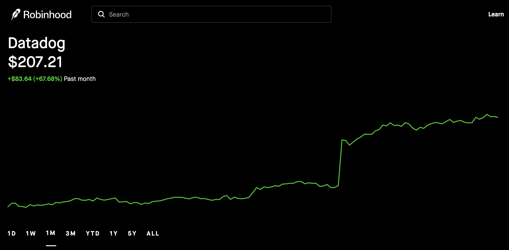
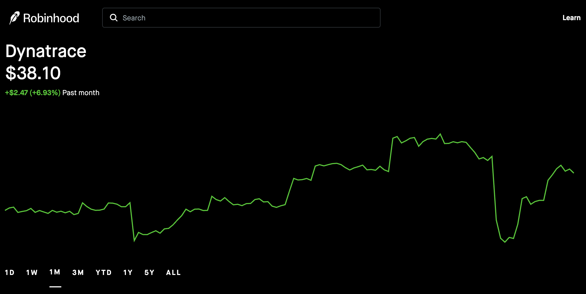

+++
author = "GreyWind"
description = "An investor’s look at Infra SaaS in China and the United States."
date = '2026-05-17T16:32:02+08:00'
modified = '2026-05-17T17:10:02+08:00'
tags = [
  'SaaS', 'Invest'
]
title = 'China vs. U.S. SaaS Markets'
image = 'background.png'
+++

> Disclaimer: This article is based on my experience in the SaaS industry. It looks at the China-U.S. Infra SaaS market from an investor’s perspective, with a few notes for SaaS practitioners. It is not investment advice, only my personal view.

## Introduction

[In my previous essay on the revaluation of the SaaS industry](https://fuwx295.github.io/p/revaluing-saas-a-practitioners-perspective/), I wrote about how AI is pressuring the traditional valuation framework for software companies. I also questioned whether companies like Datadog could continue to deserve premium long-term multiples.

Datadog’s latest earnings gave a pretty direct answer.

> According to Datadog’s Q1 2026 results, quarterly revenue reached $1.006 billion, up 32% year over year. Operating cash flow was $335 million, and free cash flow was $289 million. The company had about 4,550 customers with ARR above $100,000, up 21% year over year. It also released or advanced products such as MCP Server, Bits AI Security Agent, GPU Monitoring, and Experiments.[^1]

At the very least, this tells us one thing: AI is not simply weakening every software company. In areas like observability, security, and infrastructure protection, AI may actually be expanding what Datadog can observe, analyze, and charge for.

The reason is not complicated. AI applications do not run in a vacuum. Behind a single agent request, there may be model calls, tool calls, database queries, vector search, permission checks, logs, cost tracking, security audits, and retry logic. The more complex the system becomes, the more observability it needs.

Reuters also noted in its coverage of Datadog’s earnings that generative AI and cloud migration are driving demand for monitoring, security, and infrastructure protection tools. After Datadog raised its full-year outlook, its stock rose sharply.[^2]

I personally benefited from this rally as well. But the more interesting question is not the short-term return. It is this: what kind of software company is the market actually revaluing?

As someone working in China’s enterprise software and observability space, I deal less with the clean, lightweight, high-margin SaaS story often found in U.S. earnings reports, and more with private deployments, customer-specific adaptation, bidding processes, on-site support, acceptance testing, and one-off customization.

This work has value. It is also the everyday reality of China’s enterprise software market. But from an investor’s point of view, it does not naturally grow into a high-multiple Infra SaaS company like Datadog.

So this article is not really about all SaaS. It is about Infra SaaS, represented by companies like Datadog. Why can the U.S. produce platform-style Infra SaaS companies with high gross margins, high net retention, global reach, and usage-driven revenue, while many Chinese enterprise software companies end up looking more like project-based vendors, system integrators, or private-deployment teams?

## SaaS

SaaS stands for Software as a Service. But from an investor’s perspective, the definition itself is not the point. What really matters is revenue quality.

Whether a software company is “cloud-based” is not the core issue. The real questions are: Is the revenue recurring? Is the product reusable? Will customers naturally expand usage? Can gross margins hold up? Is delivery lightweight enough? Is the addressable market large enough?

A high-quality SaaS company is not selling one project after another. It is selling a product capability that can be repeatedly replicated.

| Category | Examples | Pricing Model | What Investors Care About |
|---|---|---|---|
| Application SaaS | Salesforce, ServiceNow, Adobe | Seats, modules, subscriptions | Retention, ARPU, category expansion |
| Infra SaaS | Datadog, Dynatrace, Snowflake, Cloudflare | Usage + subscription | Data growth, customer expansion, gross margin |
| Cloud infrastructure | AWS, Azure, Alibaba Cloud | Compute, storage, bandwidth | Scale effects, capex, price competition |

Datadog is closer to Infra SaaS than to traditional enterprise management software. It is not selling a single function. It is selling the ongoing need for observability, security, cost governance, and engineering efficiency as enterprise technology systems become more complex.

The same $100 million in revenue is valued very differently depending on whether it comes from recurring SaaS ARR or project-based contracts: one is predictable and scalable, while the other often carries delivery pressure, long collection cycles, customization, and margin uncertainty.

Investors do not assign high valuations to SaaS companies simply because they call themselves SaaS. They do it when several conditions are true at the same time: high gross margin, low marginal delivery cost, high net retention, natural customer expansion, predictable revenue, and sustainable sales efficiency.

The problem for many Chinese enterprise software companies is not that they have no revenue or no customers. The problem is that it is hard for all of these metrics to be true at the same time.

## Datadog

Datadog is being revalued by the market because it sits in a place where system complexity continues to rise.

### Platform

Datadog started with cloud-native observability products such as metrics, logs, APM, and tracing. It later expanded into security, cloud cost management, database monitoring, user experience monitoring, CI/CD, LLM Observability, GPU Monitoring, and more.

That means Datadog is no longer just a monitoring tool. It is becoming a unified observability platform sitting on top of the enterprise technology stack.

### Complexity

The more complex enterprise systems become, the more services they run, the longer their call chains become, and the more logs, metrics, traces, profiles, and security signals they generate.

Datadog’s value is not that it stores a few more log lines. Its value is that it organizes scattered system signals and turns them into part of debugging, security, cost governance, and engineering collaboration.

### AI

After AI agents enter the picture, a single user request may no longer call just one backend API. It may trigger multiple LLM calls, multiple tool calls, multiple external services, multiple database queries, and multiple vector search workflows.

Latency, error rates, token cost, context length, prompt versions, tool calls, hallucination risk, and security audits along these chains all need to be monitored, traced, and governed.

Datadog’s LLM Observability documentation shows that it can capture metrics such as spans, errors, token usage, and latency in LLM applications. Its product materials also note that calls to models such as OpenAI and Anthropic can be recorded as LLM spans.[^3]

Datadog’s MCP Server connects production data such as logs, metrics, and traces to AI coding agents like Claude Code, Cursor, and Codex for debugging and incident investigation.[^4]

This is not just adding an AI feature to an old product. It is turning AI applications themselves into a new object of observability.

Of course, Datadog’s strength should not be attributed only to AI. Cloud migration, security demand, large-customer expansion, a more complete platform portfolio, and a recovery in prior market expectations may all have contributed to this revaluation. AI is better understood as a new incremental variable, not the only reason.

### Expansion

A customer may start with basic monitoring, then expand into APM, logs, security, cloud cost management, databases, LLM Observability, GPU Monitoring, and more.

This is the expansion revenue that SaaS investors care about. The company is not reselling the same customer from scratch every year. It is continuously expanding inside the same account.

Datadog’s value is not that it is called SaaS. Its value is that it can turn customer system complexity into billable, expandable, and durable revenue.

## Dynatrace

Dynatrace is in the same observability market, and its fundamentals are not weak.

Dynatrace’s FY2026 Q4 results showed ARR of $2.054 billion, up 18% year over year. Quarterly revenue reached $532 million, up 19%. Full-year free cash flow was $529 million. The company is also pushing into areas such as MCP Server, AI observability, and telemetry pipelines.[^5]

But capital markets do not react to every company in the same way. Barron’s noted in its coverage of Dynatrace’s earnings that although the company beat expectations on revenue and profit, its stock still fell. The market cared more about future growth guidance and ARR growth.[^6]

This shows that investors are not looking only at current revenue and profits. They are also looking at where future workloads are moving, how much growth elasticity remains, and how strong the story is.

Even within the same observability market, investors separate two types of assets. One is a stable enterprise software company with decent growth and solid profitability. The other is a platform that may capture incremental demand from AI workloads, agent workflows, GPUs, and LLM telemetry.

This does not mean Dynatrace has no value. It simply shows that valuation differences among software companies do not come only from current financial metrics. They also come from the market’s view of where future technology workloads are going.

This brings us back to China: why do A-share and Hong Kong markets rarely produce Infra SaaS assets like Datadog that can be revalued by global capital? China has related products and real demand. What is rare is a company that simultaneously meets all of these conditions: standardized product, usage-driven revenue, low marginal delivery cost, high net retention, global expansion, and a public-market premium valuation.

## Key Differences Between China and the U.S.

China does not lack enterprise software demand. Enterprises, government agencies, financial institutions, manufacturers, and internet companies all need digitalization, automation, security, observability, and AI engineering capabilities.

The real issue is how that demand is monetized. It is often not released through standardized SaaS subscription revenue, but through projects, private deployments, customization, bidding, on-site delivery, and acceptance-based payment.

### Customers

The U.S. market has a large base of commercial customers willing to pay for efficiency, compliance, security, and engineering capability. Grand View Research estimated that the U.S. SaaS market generated about $140.73 billion in revenue in 2024 and could reach $271.74 billion by 2030.[^7]

China’s SaaS market is also growing. Grand View Research estimated China’s SaaS market revenue at about $25.86 billion in 2024 and projected it to reach $63.22 billion by 2030.[^8]

Beyond market size, the more important difference is customer structure.

In China, many high-paying customers are concentrated in government, state-owned enterprises, financial institutions, telecom operators, and large manufacturers. These customers have budgets and real needs, but they often require private deployment, domestic IT stack adaptation, security review, custom development, project acceptance, and on-site support.

The revenue is real. But the most valuable parts of SaaS — standardized delivery and economies of scale — get weakened.

### Delivery

In the ideal version of SaaS, you write the software once and serve many customers.

But in China’s enterprise software market, many companies eventually become one version per customer, one delivery team per project, and one acceptance cycle per contract.

The result is familiar: lower gross margins, longer collection cycles, R&D resources dragged into custom requests, slower product iteration, and revenue that may grow on the surface while its quality starts to resemble outsourcing, system integration, or project-based software.

The China Academy of Information and Communications Technology also noted in its *China Enterprise SaaS Industry Development Research Report (2024)* that SaaS vendors, in order to expand their markets, have begun offering private or hybrid deployment models and custom development services to meet large-customer needs. The focus of service has also shifted from generic standardization toward customized non-standard delivery.[^9]

Project-based software is not worthless. The issue is that it has high marginal delivery cost, large customer-to-customer variation, and weak revenue predictability. It is hard for this kind of business to receive the same valuation framework as U.S.-listed SaaS companies.

### Cost Structure

This point is often overlooked in SaaS analysis, especially when people talk about Infra SaaS.

Companies like Datadog, Snowflake, and Cloudflare may look like software companies, but in reality they also operate heavy infrastructure businesses. Logs, metrics, traces, profiles, and model-call data all need to be collected, transmitted, stored, indexed, and queried. The larger the data volume, the more real the bandwidth, storage, compute, and operations costs become.

So for Infra SaaS, revenue growth alone is not enough. You also need to ask whether unit costs can decline with scale. As customer usage grows, revenue may rise. But if bandwidth, storage, and compute costs rise at the same time, gross margin gets eaten away. A truly strong Infra SaaS company must turn more data volume into more revenue, not just more cost.

Leading U.S. cloud providers are backed by more mature global infrastructure. AWS says its global backbone spans nearly 20 million kilometers of fiber. Google Cloud also states that its global network connects more than 200 countries and includes 10 million kilometers of fiber.[^10][^11]

That means U.S. Infra SaaS companies grow inside a more mature and scalable cloud infrastructure ecosystem. Cloud providers, CDNs, IDCs, network interconnection, and developer ecosystems are relatively mature. Software companies can buy and use infrastructure in a more standardized way, and they can spread R&D, bandwidth, storage, sales, and brand costs across global customers.

China’s network cost structure is different.

In China, backbone networks, metro networks, IDCs, leased lines, public internet egress, and cross-carrier interconnection have long been dominated by the three major telecom operators. Cloud providers and SaaS companies cannot complete delivery simply by buying servers and disks. Once a service involves public internet access, cross-region transmission, cross-carrier networking, customer leased lines, private deployment, or IDC hosting, bandwidth and network resources become very real costs.

Because the three major telecom operators control network, data center, leased-line, and bandwidth resources, they also have more leverage over network costs. CAICT noted in a report on third-party data center operators that one of the important services provided by basic telecom operators in building data centers is to offer customers data center space and bandwidth resources.[^12]

Wallstreetcn, citing Goldman Sachs analysis, also reported that operator clouds have lower bandwidth costs than other cloud companies because they use their own network infrastructure. Other cloud companies need to pay operators for bandwidth and private network connections across different data centers.[^13]

Most Chinese SaaS companies do not control these underlying resources. They either buy compute and storage from cloud providers or buy bandwidth, leased lines, and data center resources from telecom operators or IDC systems. For data-heavy products such as logs, monitoring, security, analytics, and AI workflows, usage growth does not automatically become profit growth. If pricing is locked inside project budgets while bandwidth, storage, deployment, and network costs keep rising, gross margin gets compressed first.

Of course, U.S. Infra SaaS companies also face high cloud, storage, and network costs. The difference is that when customers accept standard subscriptions or usage-based pricing, those costs can at least be passed through the pricing mechanism. Under project pricing, private deployment, one-off procurement, and acceptance-based payment, the price is locked by the project budget while costs keep changing with the environment, data volume, network conditions, and customer requirements.

That is why bandwidth and infrastructure cost are not a side issue for Infra SaaS. They directly determine whether more usage becomes more revenue, or simply more cost. In the U.S. market, mature cloud infrastructure, standardized pricing, and global customer scale make it easier to spread these costs. In China, network resource structure, private deployment, cross-carrier costs, and project-based procurement can squeeze the business at the same time.

This is one reason U.S. enterprise software companies can more easily tell a story of “usage growth, stable gross margin, and global expansion,” while many Chinese enterprise software companies end up with a different story: revenue has grown, but headcount has grown too, delivery has become heavier, and costs have gone up as well.

### Labor

One underlying assumption behind U.S. SaaS is simple: labor is expensive, so expensive software can still sell.

In areas such as HR, finance, sales, customer support, DevOps, security, and data analytics, as long as software can replace part of the labor, reduce risk, or improve efficiency, companies have a reason to keep paying for it.

China’s issue is that in many scenarios, labor, outsourcing, and on-site implementation remain relatively cheap. Customers can easily compare the price of standardized software with the cost of outsourcing, custom development, or internal teams.

That weakens SaaS pricing power and pushes enterprise software companies into more customized delivery.

### Procurement

U.S. enterprise software buyers are more used to subscriptions, usage-based pricing, and multi-year contracts. Many Chinese government and enterprise customers are more used to project approval, bidding, one-off procurement, private deployment, acceptance-based payment, and later maintenance contracts.

This naturally conflicts with the SaaS model of ARR, NRR, and consumption expansion.

U.S. SaaS companies sell ongoing services. Many Chinese enterprise software companies sell project acceptance.

This does not mean the project model is always bad. It just means it is hard for that model to receive a standard SaaS valuation.

### Market Radius

U.S. SaaS companies also have an often underestimated advantage: market radius.

An English-language product naturally covers a larger commercial market. Dollar pricing raises ARPU. Global cloud infrastructure is mature. Developer ecosystems and enterprise IT budgets are highly globalized. If a product works in the U.S., the path to Europe, Japan, Australia, Singapore, and other markets is relatively clear.

This is especially important for Infra SaaS.

Global customers do not only mean more revenue. They also make it easier to spread costs. R&D, sales, brand, compliance, and infrastructure spending can all be absorbed by a larger customer pool. Customers in different time zones may also help reduce load concentration in a single region’s working hours. This is not the deciding factor, but it does matter for the cost efficiency of large-scale cloud services.

Chinese SaaS companies going overseas face barriers in language, localization, data compliance, payments, sales channels, brand trust, overseas ecosystem integrations, and partnerships.

So the problem for Chinese SaaS is not only that the domestic market is weaker. It is also that the global expansion radius is more limited. Many enterprise software companies can only spread costs across a limited set of domestic customers while still carrying heavy customization, on-site support, and delivery costs.

Of course, not every U.S. SaaS company has this kind of quality either. The U.S. also has many software companies with slowing growth, heavy consulting delivery, intense competition, or valuation pressure from AI. The companies that receive premium valuations are the few that can prove high retention, high expansion, low marginal delivery cost, and a long-term market opportunity.

## The Chinese Market

China certainly has enterprise software and cloud-oriented companies, including Kingsoft Office, Yonyou, Kingdee, Glodon, Weaver, Seeyon, Sangfor, and others. But most of them are not Datadog-style Infra SaaS assets: standardized, usage-driven, globally scalable platforms with low marginal delivery cost, strong net retention, and developer-led adoption.

That is why many Chinese enterprise software companies may have meaningful revenue and plenty of customers, yet public markets are still unwilling to give them U.S.-style SaaS multiples. The reason is not whether there is software. It is that revenue quality, delivery model, customer structure, cost structure, and expansion radius are different.

There are still opportunities. But investors cannot simply copy the U.S. SaaS valuation playbook.

What deserves attention is not the broad concept of “SaaS,” but the specific categories that may generate higher-quality revenue.

| Direction | Investment Logic |
|---|---|
| Global SaaS | Bypass domestic project-based delivery and weak pricing by entering global subscription markets |
| Vertical AI SaaS | Build moats through industry data, workflow know-how, and delivery experience |
| Infra / Observability / Security | As AI system complexity rises, domestic demand for monitoring, security, and governance should also grow |
| Standardized private-deployment products | Adapt to government and enterprise deployment needs while reducing erosion from project-based work |
| AgentOps / LLMOps | New tool layers created by new workloads, not yet fully monopolized by incumbents |

Whether these areas can receive premium valuations from capital markets eventually comes back to a few questions: Is the revenue durable? Is the product repeatable? Can customers expand? Can gross margins hold up? Can the company move from project revenue toward productized revenue?

Reuters has recently reported several times that AI is creating a clearer split in software stocks: some traditional software companies are seeing valuations pressured by AI substitution risk, while infrastructure, cloud security, and AI-related software companies are benefiting.[^14]

Future software investing will no longer be as simple as buying anything labeled “software.” Investors will need to ask where exactly the software sits in the value chain.

## For Practitioners

For investors, this is a revenue-quality problem. For practitioners, it is a career-compounding problem.

If a company’s growth mainly depends on projects, headcount, and customization, then the capital market will not give it a premium valuation. Individuals inside the company may also struggle to build career leverage through product compounding.

If your daily work is repeatedly doing POCs, rewriting bidding materials, adapting to customer environments, handling private deployments, supporting on-site pre-sales and post-sales work, maintaining different versions for different clients, chasing acceptance, filling out documents, and firefighting at customer sites, then you are probably already inside the most typical trap of China’s enterprise software market.

There is plenty of work. There is real demand. People are tired. But it is hard for that work to accumulate into the kind of high-quality revenue that capital markets truly like.

Many projects are held together by this hard, messy, unglamorous work. It is not worthless. But if a company can only grow by adding more people, more on-site delivery, and more custom work, it will have a hard time becoming a high-quality SaaS asset.

For individuals, this is not simply about “just leave.” The more practical question is: Can what you are building today eventually become a product? Can it be reused? Can it make the next customer easier to sell to and easier to deliver?

If the answer stays no for a long time, that is a warning sign.

Not everyone can switch directions immediately. But at the very least, it is worth moving as much as possible toward productization, platformization, standardization, globalization, or areas such as AI Infra, Observability, Security, and AgentOps — areas where high-quality revenue is more likely to form.

People can work hard. But ideally, that hard work should not be trapped forever inside a low-margin part of the value chain.

## Conclusion

Datadog’s strength is not an accident.

It sits at the intersection of cloud-native infrastructure, AI applications, agent workflows, GPU resources, enterprise security, and rising system complexity. Its revenue grows as customer system complexity and data volume grow.

By contrast, China’s enterprise software market does not lack demand. But more of that demand is released through projects, private deployments, customization, and government-enterprise procurement. This market structure suppresses the gross margin, retention, expansion revenue, and global repeatability of standardized SaaS.

At a deeper level, the difference is not only the sales model. It comes down to three things: infrastructure and bandwidth costs, private and customized delivery, and global market radius.

Together, these three factors determine whether a software company is selling a repeatable product or selling one project after another.

China does not lack the concept of SaaS. It does not lack enterprise software demand either. What it lacks are Infra SaaS companies that can turn complexity into billable, expandable, and durable revenue.

Datadog has turned the rising complexity of the AI era into a high-quality software asset.

That is what investors are willing to revalue.

## References

[^1]: Datadog, “Datadog Announces First Quarter 2026 Financial Results”, May 7, 2026. https://investors.datadoghq.com/news-releases/news-release-details/datadog-announces-first-quarter-2026-financial-results

[^2]: Reuters, “Datadog raises annual forecast on strong cloud security demand, shares jump 36%”, May 7, 2026. https://www.reuters.com/technology/datadog-raises-annual-forecast-strong-cloud-security-demand-shares-up-29-2026-05-07/

[^3]: Datadog, “LLM Observability Metrics” and “LLM Observability”. https://docs.datadoghq.com/llm_observability/monitoring/metrics/ ; https://www.datadoghq.com/product/ai/llm-observability/

[^4]: Datadog, “MCP Server”. https://www.datadoghq.com/product/ai/mcp-server/ ; https://docs.datadoghq.com/bits_ai/mcp_server/

[^5]: Dynatrace, “Dynatrace Reports Fourth Quarter and Full Year Fiscal 2026 Financial Results”, May 14, 2026. https://ir.dynatrace.com/news-events/press-releases/detail/425/dynatrace-reports-fourth-quarter-and-full-year-fiscal-2026-financial-results

[^6]: Barron’s, “Dynatrace Stock Falls on Earnings Beat. Why the CEO Thinks the Market Got It Wrong.” https://www.barrons.com/articles/dynatrace-earnings-stock-price-da8f29e9

[^7]: Grand View Research, “U.S. Software As A Service Market Size & Outlook, 2030”. https://www.grandviewresearch.com/horizon/outlook/software-as-a-service-saas-market/united-states

[^8]: Grand View Research, “China Software As A Service Market Size & Outlook, 2030”. https://www.grandviewresearch.com/horizon/outlook/software-as-a-service-saas-market/china

[^9]: China Academy of Information and Communications Technology, *China Enterprise SaaS Industry Development Research Report (2024)*. https://www.caict.ac.cn/kxyj/qwfb/ztbg/202408/P020240815374016912879.pdf

[^10]: AWS, “Global Infrastructure”. https://aws.amazon.com/about-aws/global-infrastructure/

[^11]: Google Cloud, “Global Locations - Regions & Zones”. https://cloud.google.com/about/locations

[^12]: China Academy of Information and Communications Technology, *Analysis Report on China’s Third-Party Data Center Operators*, 2022. https://www.caict.ac.cn/kxyj/qwfb/ztbg/202204/P020220408530633654580.pdf

[^13]: Wallstreetcn, “Cloud revenue share is higher than Alibaba’s: Don’t forget China’s three major telecom operators in AI infrastructure”, February 25, 2025. https://wallstreetcn.com/articles/3741901

[^14]: Reuters, “AI deepens US tech divide as IBM, ServiceNow spark software selloff, TI lifts chipmakers”, April 23, 2026. https://www.reuters.com/business/us-software-stocks-slide-ibm-servicenow-results-reignite-ai-disruption-fears-2026-04-23/